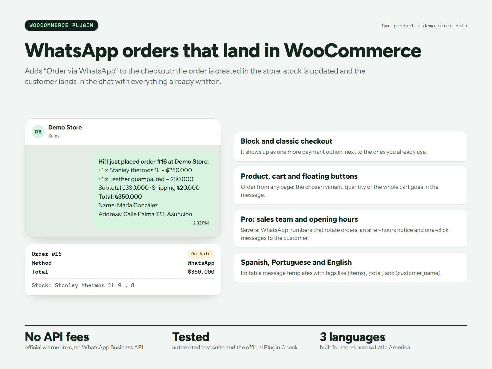

# Kanasta: Chat Orders for WooCommerce

[](https://github.com/nandres/kanasta/actions/workflows/ci.yml)

Plugin de WooCommerce para que el cliente haga un pedido real y lo envíe por WhatsApp con un toque. El pedido se crea en la tienda, descuenta stock y se abre el chat con el detalle ya escrito. No usa la API de WhatsApp Business ni tiene costos por mensaje.

**Página del producto:** https://kanasta-wp.vercel.app



*Los datos de la imagen son de una tienda de demostración.*

> Este repositorio tiene la **versión gratis** (1.2.0). Kanasta Pro se vende aparte y su código no está acá. Enviado a wordpress.org: en revisión.

## Qué hace

- **Método de checkout «Order via WhatsApp»**, en el checkout de bloques y en el clásico.
- **Botón en el producto**, con la variante y la cantidad elegidas, y **botón en el carrito** con todo el pedido.
- **Botón flotante** en todas las páginas; el mensaje incluye la página desde la que escriben.
- **Mensajes editables** con etiquetas como `{order_number}`, `{items}`, `{total}` y `{customer_name}`.
- **Página de pedido recibido y correo** con el botón para enviar el pedido por WhatsApp.
- **Estado del pedido a elección:** en espera (reserva stock), pago pendiente o procesando.
- Compatible con HPOS. Traducido a español y portugués.

## Requisitos

WordPress 6.5, PHP 7.4 y WooCommerce 8.6 o superiores.

## Instalarlo

1. Bajá el repositorio con **Code → Download ZIP** y renombrá la carpeta a `kanasta` dentro del zip.
2. En WordPress, andá a **Plugins → Añadir nuevo → Subir plugin**.
3. Activalo y cargá tu número de WhatsApp, con el código de país, en **WooCommerce → Kanasta**.

## Código

```text
kanasta.php     Arranque del plugin
includes/       Pago, botones, bloques, mensajes y ajustes
assets/         CSS y JavaScript
languages/      Traducciones
vendor/         SDK de Freemius
```

El CI revisa la sintaxis de PHP en las versiones 7.4 y 8.3.

## Licencia

[GPL-2.0-or-later](LICENSE). WhatsApp es una marca de WhatsApp LLC y WooCommerce de Automattic Inc.; Kanasta es un plugin independiente, sin relación con ellas.

Hecho por **Marcos Arellano** · [marcos-arellano.vercel.app](https://marcos-arellano.vercel.app)
